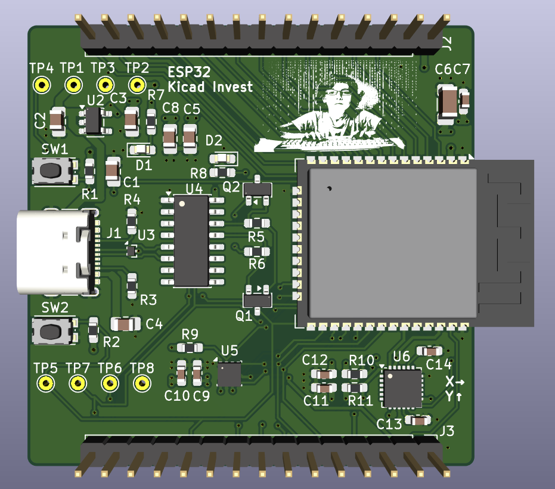
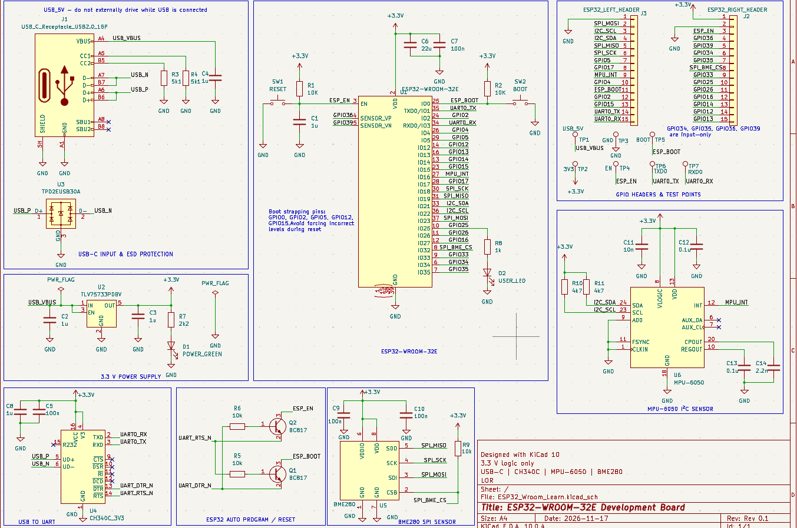
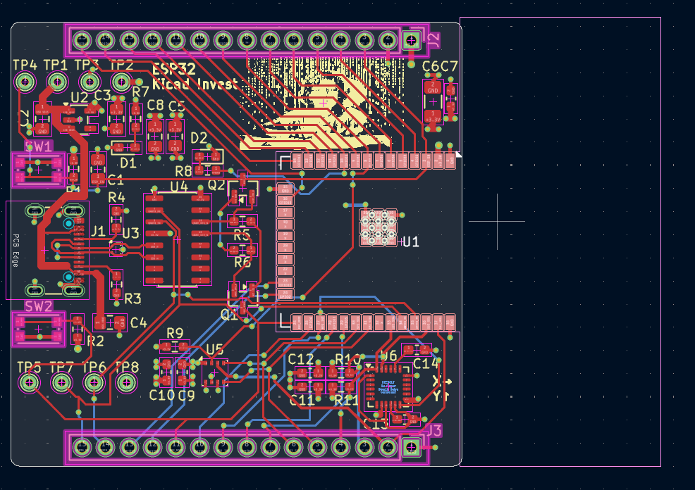
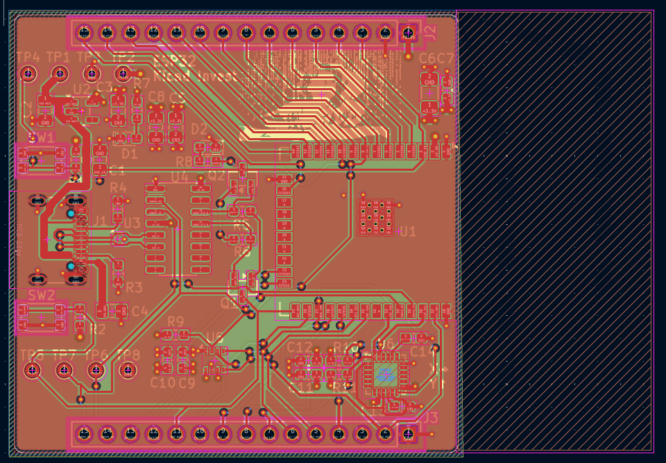

# ESP32-WROOM-32E Learning Board

A four-layer ESP32 development board designed in **KiCad 10** as a practical learning project. The board combines USB-C power and programming, automatic boot control, environmental sensing, motion sensing, GPIO expansion, and a PCB antenna-aware layout.



## Project Goals

This project was created to learn and practice:

- Schematic capture and electrical rule checking
- Component selection and footprint management
- Four-layer PCB stack-up planning
- Component placement and signal routing
- USB 2.0 Full-Speed routing and ESD protection
- Ground planes, copper pours, and stitching vias
- ESP32 boot-strapping and automatic programming circuits
- RF antenna placement and copper keepout design
- Design rule checking and manufacturing preparation

## Hardware Overview

The board is built around an **ESP32-WROOM-32E** Wi-Fi and Bluetooth module and includes:

- USB-C connector for 5 V power and programming
- TPD2EUSB30A protection for the USB data lines
- CH340C USB-to-UART converter
- Automatic reset and boot circuit using DTR/RTS
- TLV75733 3.3 V linear regulator
- BME280 temperature, humidity, and pressure sensor over SPI
- MPU-6050 six-axis accelerometer and gyroscope over I2C
- RESET and BOOT push buttons
- User and power indicator LEDs
- GPIO headers and test points for power, UART, EN, and BOOT

## Schematic Design

The schematic is separated into functional blocks for easier review and debugging. It includes USB-C input and protection, power regulation, USB-to-UART conversion, ESP32 boot control, sensors, GPIO headers, and test points.



Important design details include:

- Separate 5.1 kΩ pull-down resistors on USB-C CC1 and CC2
- ESD protection placed on the USB D+ and D− signals
- 10 kΩ pull-ups on ESP32 EN and GPIO0
- Local decoupling capacitors close to each IC
- I2C pull-ups for the MPU-6050 interface
- Clearly identified ESP32 strapping pins on the schematic
- Test points for the main power and programming signals

## PCB Layout

The PCB uses the following four-layer structure:

| Layer | Purpose |
|---|---|
| `F.Cu` | Components, primary signal routing, and GND copper pour |
| `In1.Cu` | Continuous GND reference plane |
| `In2.Cu` | 3.3 V power plane |
| `B.Cu` | Secondary routing and GND copper pour |

The routing view below shows component placement, signal fan-out, vias, and the ESP32 module before the outer-layer copper fills are emphasized.



## Grounding and Power Distribution

Ground pours are used on both outer copper layers and connected to the internal GND plane with stitching vias. The internal ground plane provides a short return path beneath signal traces, while the internal 3.3 V plane distributes power across the board.



The filled-zone view also highlights several layout decisions:

- GND stitching vias connect the outer pours to the internal ground plane
- Copper islands are removed when they cannot connect reliably to GND
- USB and IC ground connections have short paths to the reference plane
- The ESP32 antenna area is kept free of copper, tracks, pads, and vias
- The module antenna extends beyond the carrier-board edge to reduce RF interference

## ESP32 Antenna Placement

The ESP32-WROOM-32E is positioned at the edge of the carrier PCB. The antenna section extends beyond the `Edge.Cuts` boundary, and a multilayer keepout prevents copper and routing from entering the antenna region.

This placement is intended to reduce detuning caused by the carrier PCB and nearby copper. The final enclosure should also keep metal, wiring, and batteries away from the antenna.

## 3D Preview

The 3D rendering at the top of this README is used to review component orientation, connector access, silkscreen readability, and the ESP32 antenna overhang. It also provides a quick mechanical check before generating manufacturing files or designing an enclosure.

## Current Status

This is an educational work in progress. The main schematic and PCB routing are complete, and the design currently includes:

- A project-specific ESP32 footprint with antenna keepout rules
- 0.3 mm thermal-via drills under the ESP32 exposed GND pad
- Outer-layer GND pours and GND stitching vias
- Dedicated internal GND and 3.3 V planes
- USB-C, USB-to-UART, automatic programming, and sensor interfaces

Before manufacturing, the design still needs a final ERC/DRC pass, verification against the selected PCB manufacturer's four-layer stack-up, and a final Gerber and drill-file review.

## Repository Structure

```text
.
|-- ESP32_Wroom_Learn.kicad_pro   # KiCad project settings
|-- ESP32_Wroom_Learn.kicad_sch   # Main schematic
|-- ESP32_Wroom_Learn.kicad_pcb   # Four-layer PCB layout
|-- ESP32_Wroom_Learn.pretty/     # Project-specific footprints
|-- fp-lib-table                   # Project footprint-library table
|-- libraries/                    # Project-specific library resources
`-- docs/images/                  # README screenshots
```

## Requirements

- KiCad 10 or later

Open `ESP32_Wroom_Learn.kicad_pro` from the KiCad Project Manager to load the schematic, PCB, and project-specific libraries.

## Learning Notes

Some of the most useful lessons from this project were:

1. A clean schematic structure makes layout and debugging much easier.
2. A continuous reference plane is more important than forcing copper into every small gap on an outer layer.
3. Copper pours must be refilled and checked after changing the board outline or keepout regions.
4. Stitching vias are useful only when they are assigned to GND and connect otherwise separated ground regions.
5. ESP32 antenna placement must be considered before finalizing the board outline and component placement.
6. Custom footprints should be stored in the project library instead of modifying KiCad's system libraries.
7. ERC and DRC reports must be regenerated after the latest design changes rather than relying on old reports.

## License

No license has been selected yet. Unless a license is added, the design is publicly viewable but is not automatically licensed for reuse or redistribution.
